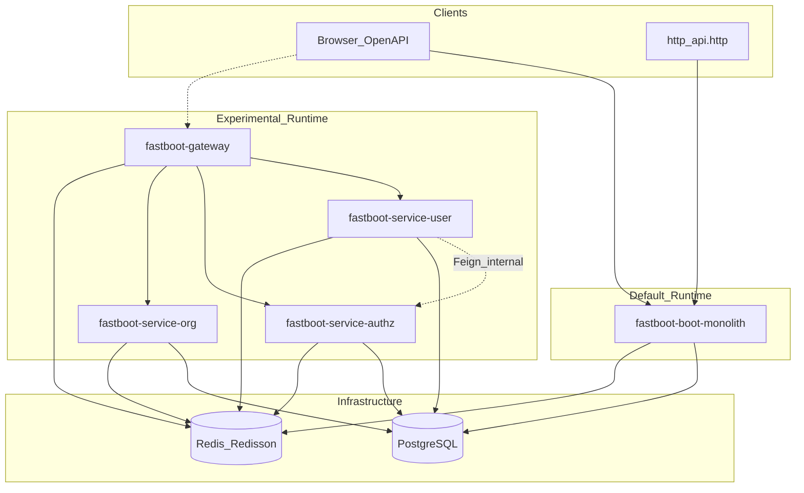
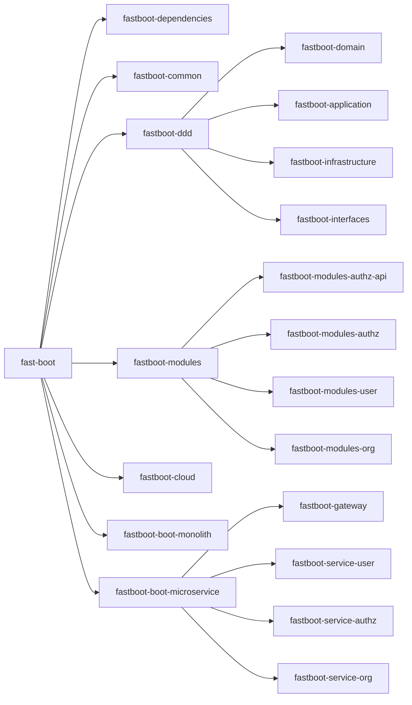
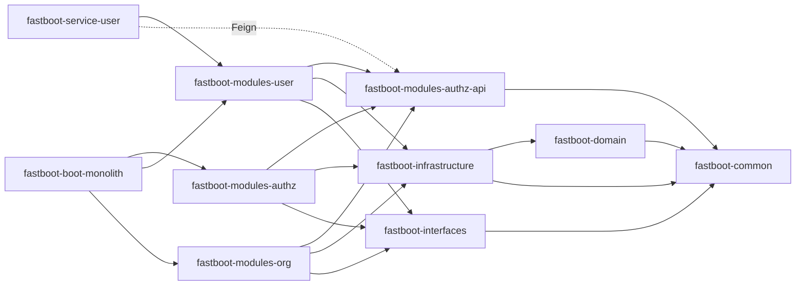
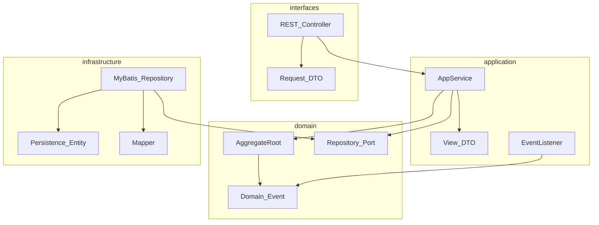
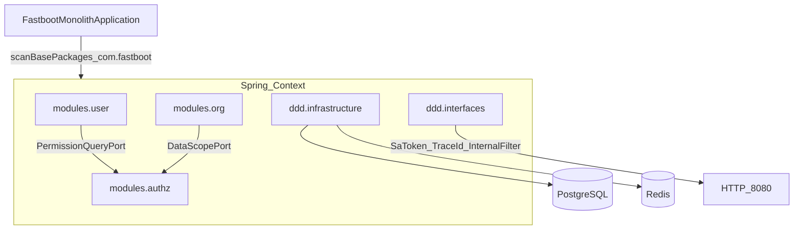
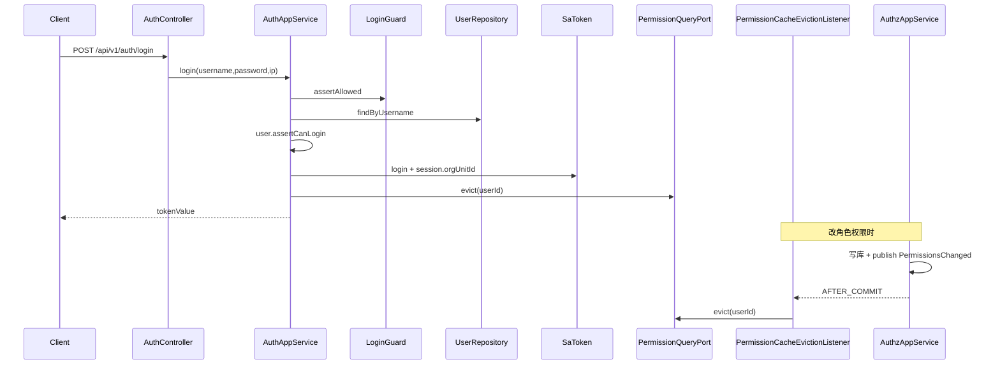
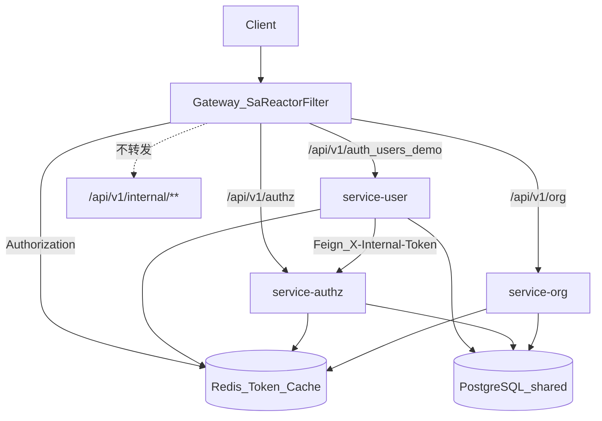
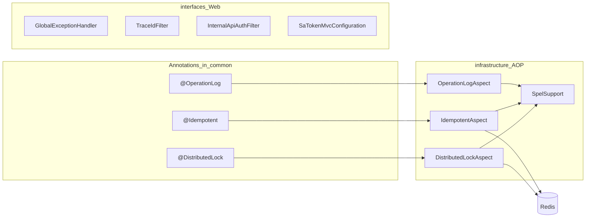

# fast-boot 架构说明

本文描述当前仓库的运行时形态、Maven 模块边界与关键调用链。默认交付为**模块化单体**；微服务拆分为实验路径。

相关决策见 [ADR](adr/0001-modular-monolith.md)、[六边形模块](adr/0002-hexagonal-modules.md)、[API 契约](adr/0003-module-api-contracts.md)。

---

## 1. 总体视图



- **推荐路径**：客户端 → `fastboot-boot-monolith` → PostgreSQL / Redis
- **实验路径**：客户端 → Gateway（Sa-Token）→ user / authz / org 服务；user 经 Feign + `X-Internal-Token` 调 authz 内部接口

---

## 2. Maven 模块结构



| 模块 | 职责 |
| --- | --- |
| `fastboot-dependencies` | 第三方与内部模块版本 BOM |
| `fastboot-common` | `R`、错误码、锁/幂等/审计注解 |
| `fastboot-domain` | 聚合根基类、领域事件发布端口 |
| `fastboot-application` | 应用层内核占位（薄） |
| `fastboot-infrastructure` | MyBatis、Flyway、AOP、事件发布适配器 |
| `fastboot-interfaces` | 全局异常、Sa-Token MVC、内部 API 鉴权、TraceId |
| `fastboot-modules-authz-api` | 跨模块契约：`PermissionQueryPort` / `DataScopePort` |
| `fastboot-modules-user` | 登录认证、用户组织归属 |
| `fastboot-modules-authz` | RBAC、权限缓存、菜单角色 |
| `fastboot-modules-org` | 组织树、数据范围过滤 |
| `fastboot-boot-monolith` | 默认启动器 |
| `fastboot-boot-microservice/*` | 网关 + 实验性拆分服务 |

---

## 3. 模块依赖关系（改造后）

跨业务模块只允许依赖 `*-api` 契约，不得依赖对方的 `application` / `infrastructure`。



ArchUnit（`ModuleArchitectureTest`）约束要点：

- `domain` 不依赖 Spring / MyBatis / Sa-Token
- 模块切片互不依赖，仅放行对 `..modules.authz.api..` 的依赖
- `application` 不依赖 `interfaces`
- user / org 的 `application` 不依赖 `infrastructure.mapper`

---

## 4. 业务模块内部分层（六边形）

每个 `fastboot-modules-*` 遵循同一分层：



| 包 | 允许依赖 | 典型内容 |
| --- | --- | --- |
| `interfaces` | application、common、框架注解 | Controller、`*Request` |
| `application` | domain、api 契约、common | `*AppService`、`application.dto.*View` |
| `domain` | common、ddd-domain | 聚合、仓储端口、领域事件 |
| `infrastructure` | domain、MyBatis | Entity、Mapper、仓储实现 |
| `api`（仅 authz-api） | java、common | Port 接口与传输快照 |

---

## 5. 单体运行时装配



同一进程内：`PermissionQueryPort` / `DataScopePort` 由 authz 模块本地 Bean 实现，无远程调用。

---

## 6. 认证与授权链路（单体）



鉴权：`SaTokenMvcConfiguration` 默认校验登录；接口级权限用 `@SaCheckPermission`；权限列表由 `StpPermissionBridge` → `PermissionQueryPort`（Redis 缓存）提供。

审计：`@OperationLog(args = {...})` 只记录显式 SpEL 参数，避免密码入日志。

---

## 7. 实验性微服务拓扑



要点：

- Gateway 使用 `sa-token-reactor`，白名单来自 `fastboot.security.permit-paths`
- `/api/v1/internal/**` 不经网关对外暴露；服务间靠 `X-Internal-Token`
- user 服务：`RemotePermissionQueryAdapter` 实现 `PermissionQueryPort`，不再扫描 `modules.authz`
- org 服务当前仍共库并扫描完整 authz（后续可同样 Feign 化）
- 共享库 + 预留 schema（`V3`）仅实验，不可当生产分库方案

---

## 8. 横切能力



| 能力 | 实现位置 |
| --- | --- |
| 统一响应 / 错误码 | `fastboot-common` → `R` / `ErrorCode` / `BizException` |
| 分布式锁 / 幂等 | Redisson + AOP（`@Order(100)`，在事务外层） |
| 操作审计 | `@OperationLog` + 显式 `args` SpEL |
| 领域事件 | `AggregateRoot.registerEvent` + `DomainEventPublisher`；缓存失效走 `AFTER_COMMIT` |
| 链路 ID | `TraceIdFilter` ↔ `X-Request-Id` / MDC `traceId` |
| 内部 API | `InternalApiAuthFilter` + `fastboot.security.internal-token` |
| Schema 演进 | Flyway：`fastboot-infrastructure/.../db/migration` |

---

## 9. 目录速查

```text
fast-boot/
├── fastboot-common/                 # 公共模型与注解
├── fastboot-ddd/
│   ├── fastboot-domain/
│   ├── fastboot-application/
│   ├── fastboot-infrastructure/     # MyBatis / AOP / Flyway
│   └── fastboot-interfaces/         # Web / 安全
├── fastboot-modules/
│   ├── fastboot-modules-authz-api/  # 跨模块契约
│   ├── fastboot-modules-authz/
│   ├── fastboot-modules-user/
│   └── fastboot-modules-org/
├── fastboot-cloud/                  # 可选 Nacos 发现
├── fastboot-boot-monolith/          # 默认启动
├── fastboot-boot-microservice/      # 实验拆分
└── docs/
    ├── architecture.md              # 本文
    ├── CONTRIBUTING.md
    └── adr/
```

新增业务模块时：复制 `tools/module-template`，遵守 [CONTRIBUTING](CONTRIBUTING.md) 与 `*-api` 契约规则；需要跨模块协作时先在对应 `*-api` 中声明 Port，再在实现模块中提供 Bean。
